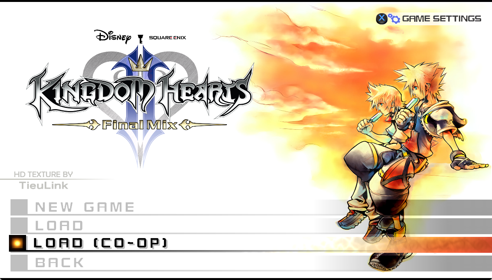

# Kingdom Hearts II Co-op Multiplayer

Online two-player co-op for Kingdom Hearts II Final Mix (PC, Steam). Each player controls Sora in their own game, and the other player appears as a second Sora in the party alongside Donald and Goofy. The host's game owns the rooms and enemies; the second game follows it.

**Status:** In development, about two thirds of the way to a full story run on two PCs, tested over Steam and Radmin VPN. There is no installer yet; see [Playing a session](#playing-a-session).

## What works
- Two PCs linked over Steam (Join Game or an invite) or a LAN / VPN address, with a **Connection lost** screen, Continue Alone, and rejoining. Co-op saves are kept apart from your normal saves (see [Saves](#saves)).
- Rooms, loading screens, cutscenes, and the World Map in sync.
- Shared enemies and bosses: the second game copies the host's ('one brain') and boss HP bars, missions, timers, and gauges follow the host's game.
- The other Sora has its own Party HUD with gauge (live HP and MP), a status box and model in the pause menu, with its player's own level and stats, and in story cutscenes holding that player's own Keyblade. Its spells, Limits and Drive Forms show with their models, motions and attack effects, and so do the world costumes (lion, retro, Halloween).
- Downed state and revives, and Mickey's rescue in co-op: one roll for both players, Mickey on both screens, either player can be the one who plays him.
- Companions leave and come back on both screens for Limits, Drive Forms, and summons; their KO, HP, MP and effects follow the host's game.
- Most RCs (reaction commands) work for both players. An RC that grabs a player is for one player at a time, and its camera shows only on that player's screen.
- HP, MP, and drive orbs drop for both players, once each, and each player picks up their own. 
- Abilities like Second Chance and Once More, including other level up mechanics like the Drive Form level-ups.

## What doesn't yet
- Gummi Ship missions: an experimental switch is built and several missions were completed on two PCs, but not enjoyable to play with yet.
- Atlantica: its songs aren't synced yet, and a pause or Retry inside a song can split the two games and crash the host's game. The plan is in [`docs/ATLANTICA_COOP.md`](docs/ATLANTICA_COOP.md).
- Some bosses' and scenes' special parts differ on the second player's side: see [Known limitations](#known-limitations).
- Many particles will be missing from the Client game.
- Many more untested world events.
- Open [`TODO.md`](TODO.md) stuff.


**Progress: about 69%** of the plan in [`TODO.md`](TODO.md), counting P0 items three times, P1 twice, P2 once and a built-but-untested item as half (re-checked 2026-11-27).

| `TODO.md` items | Done | Built, not 2 PC tested | Open |
|---|---|---|---|
| P0 (blocks the start-to-finish run) | 67 | 5 | 4 |
| P1 (needed to play well) | 138 | 59 | 60 |
| P2 (polish) | 33 | 9 | 53 |

## Route checklist
✅ played in co-op on two PCs · 🟡 partly · ⬜ not tried. Rows follow the story; worlds in the same group can be played in any order the World Map opens them. This Route checklist follows actual Co-op progress in one save.

| # | Part | Status |
|---|---|---|
| | **Start** | |
| 1 | Twilight Town (Sora wakes) | ✅ story played |
| 2 | Mysterious Tower (Yen Sid) | ✅ story played |
| 3 | Hollow Bastion 1 (the Bailey) | ✅ story played |
| | **First visits** | |
| 4 | Land of Dragons 1 (Mulan's missions, Shan-Yu) | ✅ story played |
| 5 | Beast's Castle 1 (Thresholder, Beast, Shadow Stalker / Dark Thorn) | ✅ story played |
| 6 | Olympus Coliseum 1 (Cerberus, Hades escape, Pete, Hydra) | ✅ story played |
| 7 | Disney Castle (Minnie's escort) | ✅ story played |
| 8 | Timeless River (the Windows of Time, Pete) | ✅ story played |
| 9 | Port Royal 1 (Barbossa) | ✅ story played |
| 10 | Agrabah 1 (Volcanic Lord and Blizzard Lord) | ✅ story played |
| 11 | Halloween Town 1 (Prison Keeper, Oogie Boogie) | ✅ story played |
| 12 | Pride Lands 1 (Sora is a lion; Scar) | ✅ story played |
| | **Twilight Town 2 to the 1000 Heartless** | |
| 13 | Twilight Town 2 (Nobodies at the Sandlot) | ✅ story played |
| 14 | Hollow Bastion 2 (Demyx, after Space Paranoids 1) | ✅ story played |
| 15 | Space Paranoids 1, from Hollow Bastion 2 (the Light Cycle, Hostile Program) | ✅ story played; Light Cycle minor issues |
| 16 | The Battle of the 1000 Heartless | ✅ story played |
| | **Second visits** | |
| 17 | Land of Dragons 2 (Storm Rider) | ✅ story played |
| 18 | Beast's Castle 2 (Xaldin) | ✅ story played; Xaldin's barrier stays for the second player |
| 19 | Port Royal 2 (Grim Reaper) | ✅ story played |
| 20 | Olympus Coliseum 2 (Hades) | ✅ story played |
| 21 | Agrabah 2 (Genie Jafar) | ✅ story played before carpet riding |
| 22 | Halloween Town 2 (the Experiment) | ⬜ |
| 23 | Pride Lands 2 (Groundshaker) | ⬜ |
| 24 | Space Paranoids 2 (Sark and the MCP) | ⬜ |
| | **The end** | |
| 25 | Twilight Town 3 (the Mansion's Nobodies) | ⬜ |
| 26 | Betwixt and Between (Axel) | ⬜ |
| 27 | The World That Never Was (Roxas, Xigbar, Luxord, Saïx) | ⬜ story fights not tried |
| 28 | Final fights | 🟡 played to the credits; on the second player's side the ship fight isn't in step (1.50) and the second phase of their shield break in Armored Xemnas II plays on the host's screen (1.135) |
| | **Optional** | |
| — | Atlantica (songs) | 🟡 not synced yet (5.27, 5.28) |
| — | Data Organization (Final Mix) | 🟡 played from the last save, with open issues (1.82, 1.86, 1.92, 1.94) |
| — | World Map and Gummi Ship | 🟡 World Map works; Gummi routes remain single player unless the test switch is on (5.2) |

## Saves
The title screen gets a **LOAD (CO-OP)** row under LOAD.



- **LOAD (CO-OP)** loads and saves the co-op save file, `KH2 Coop saves\KHIIFM_WW.png` in the game folder (next to the game's exe), and turns co-op on. The first time, the file starts as a copy of your normal saves.
- **NEW GAME** and **LOAD** use your normal Steam saves. The mod stays off, and the game plays as plain KH2.
- Co-op saves never contain the second Sora, so they load like any other save. Playing in co-op never writes your normal saves.
- The co-op save file holds 98 saves, not 99. Saving into the last empty slot crashes the game; saving over a slot works (1.237).

## Playing a session
There's no installer or player guide yet; this is how a test session works today.

**Requirements (both PCs):**
- Kingdom Hearts II Final Mix on Steam (the PC release).
- OpenKH Mods Manager with Panacea, and the mod from `openkh_mod/` installed in it.
- The motion files, built on each PC from that PC's own game files with `tools/make_mset.py`.

**Steps:**
1. In Mods Manager, put KH2 Coop at the top of the list (above texture or voice mods), then build. Otherwise, those mods cover the LOAD (CO-OP) label.
2. Start the game through Steam or Mods Manager, not by running the game's .exe directly: the mod uses the game's own Steam connection, which only starts that way.
3. Both players pick **LOAD (CO-OP)** on the title screen and load a save.
4. The second player opens the Steam overlay and clicks **Join Game** on the host's profile (or accepts the host's **Invite to Game**). Only the first Steam friend who joins gets in.

The host starts the game with `start_host.bat`, which sets the host's side (`CONNECT=steam`, or `CONNECT=local` for Radmin VPN or LAN; with Local, step 4 isn't needed). The shared settings in `kh2coop.ini` must match on both PCs; if they differ, the log says `SETTINGS DIFFER`. Both PCs also need the same build of the mod; builds that differ ignore each other.

The second player sets the connection in `kh2coop.ini`:

```ini
PEER=steam
; the host's SteamID64 (connect straight to that account); empty = wait for Join Game/invites
STEAM_ID=<SteamID64>
; the host's Local/LAN IP (port 27701 unless written as ip:port), used with PEER=local
LOCAL_IP=<host Local IP>
LISTEN=27702
```

**If the connection drops** (a game closes or crashes, or the network goes): after 3 seconds, the other game pauses on a **Connection lost. Reconnecting...** screen. Leave it open to wait; when the other player loads LOAD (CO-OP) again, co-op resumes by itself. Or pick:
- **Continue Alone**: the room reloads without the other Sora. A fight or boss fight starts over. When the other player returns, the room reloads again with their Sora.
- **Title Screen**: back to the title screen through the game's own soft reset.

**Achievements:** Steam achievements are blocked while co-op is on. `ACHIEVEMENTS=1` in `kh2coop_player.ini` allows them on that PC.

**After a session:** `Send logs.bat` in the mod's folder zips that PC's logs of the last 12 hours onto the Desktop.

## Known limitations
Places that needed their own rule (an exception): see [`docs/DECISIONS.md`](docs/DECISIONS.md#exceptions-to-the-general-rules).
- Timeless River, Pete's last fight: the camera at each scenery change.
- Timeless River, the scaffold: launch and Air Slash.
- The Land of Dragons' tornado and Twilight Town's skateboards.
- Port Royal: the burning barrels.
- Christmas Town: Oogie Boogie's belt jumps.
- The Land of Dragons, Storm Rider: Hang On (to be made).
- Xemnas/Final Xemnas: Reversal.
- Data Luxord: the arena-change camera (to be made).

## Videos
**Steam connection and gameplay** (October 11, 2026). Two PCs, host on the left, client on the right; the client joins through the Steam overlay. Combat and the downed/revive animation ([higher quality](https://www.youtube.com/watch?v=IJ1MecbHULk)).

https://github.com/user-attachments/assets/7729c35f-9265-43c8-bd39-6e0143e6bd12

**Cinematics** (October 11, 2026). A 'Twin Sora' follows Sora in every cutscene that has him; close-ups show one Sora. `CUTSCENE_TWIN=0` in `kh2coop_player.ini` turns it off.

https://github.com/user-attachments/assets/e788f2e3-3344-443e-82d8-c7cf5cf82415

**Mickey revival** (October 19, 2026). Both players roll a hidden number; if both pass the game's threshold, the higher roll plays Mickey. Mickey revives both players; if he drops to 1 HP, the partner gets up after 30 seconds or when healed. Mickey now shows in both games: [newer showcase](https://www.youtube.com/watch?v=tjANTo3i8uo).

https://github.com/user-attachments/assets/8653698c-f2cf-47c4-8a69-19c07efb3160

More on YouTube: [Twilight Town, Hollow Bastion and the Land of Dragons](https://www.youtube.com/watch?v=6iT6TXw1hiA) · [the 1000 Heartless](https://www.youtube.com/watch?v=f6fQo1BueY4) · [Data bosses](https://www.youtube.com/watch?v=IGRquHWYWyY).

## Layout
- `src/dll/`: the C++ DLL. OpenKH Panacea loads it from the OpenKH mod in `openkh_mod/`. Hooks use MinHook.
- `tools/`: Python helpers for building, launching test copies, packaging, and research.
- Settings: `kh2coop.ini` (shared, must match on both PCs; also holds the connection, `PEER`) and `kh2coop_player.ini` (personal, written by the DLL with defaults on first start; `DEV_LOGS=0` there turns the test logs off).
- `start_host.bat`: starts the host's game; `CONNECT=steam` or `CONNECT=local` picks how the second player connects.
- `start_pair.bat`: two copies of the game on one PC with two controllers, for testing; its **Warp key** window picks any room or fight and the Delete key warps both games there.
- Documents: [`TODO.md`](TODO.md) (the plan and what's left), [`MODLOG.md`](MODLOG.md) (the development diary), [`VERIFIED_OFFSETS.md`](VERIFIED_OFFSETS.md) (addresses, structures and game rules found on the Steam build), [`docs/DECISIONS.md`](docs/DECISIONS.md) (the co-op rules), [`docs/CRASH_RISK_REVIEW.md`](docs/CRASH_RISK_REVIEW.md) (where the DLL can crash the game), [`docs/FILE_HEAP.md`](docs/FILE_HEAP.md) (the game's file heap), [`docs/EFFECT_SYNC_PLAN.md`](docs/EFFECT_SYNC_PLAN.md) (particles in the other game), [`docs/GUMMI_COOP.md`](docs/GUMMI_COOP.md) (flying together), [`MODDING_PLAN.md`](MODDING_PLAN.md) (the original plan).

## License
Copyright (C) 2026 TCM-Murray

This program is free software: you can redistribute it and/or modify it under the terms of the GNU General Public License as published by the Free Software Foundation, either version 3 of the License, or (at your option) any later version. It is distributed WITHOUT ANY WARRANTY; see [`LICENSE`](LICENSE) for details. SPDX: `GPL-3.0-or-later`.

Third-party code: [MinHook](https://github.com/TsudaKageyu/minhook) (BSD-2-Clause), downloaded at build time.

## Credits
- **[Volpestyle/kh2-multiplayer](https://github.com/Volpestyle/kh2-multiplayer)** (GPL-3.0-or-later): this project uses their documentation and research (pointer maps, hook points, input, enemy and save-guard notes) as leads; every address taken from it is re-checked on our build before use (`VERIFIED_OFFSETS.md`).
- **[OpenKH](https://github.com/OpenKH/OpenKh)**: Panacea loads the mod's DLL, and its documentation and file-format code (e.g., the event script layout) are used as references.
- **[Expert595/kh2-multiplayer](https://github.com/Expert595/kh2-multiplayer)** and the KH2 Lua library: a few addresses used as leads.
- **[Julumisan/kh-pc-save-transfer](https://github.com/Julumisan/kh-pc-save-transfer)** (MIT): recommended to the second player for moving the host's save between Steam accounts; not included in this repository.

Kingdom Hearts and Kingdom Hearts II are the property of Square Enix and Disney. This is an unofficial fan project, not affiliated with or endorsed by them. The repository contains no game files; you need your own copy of the game.

Developed with the help of Claude (Anthropic).
