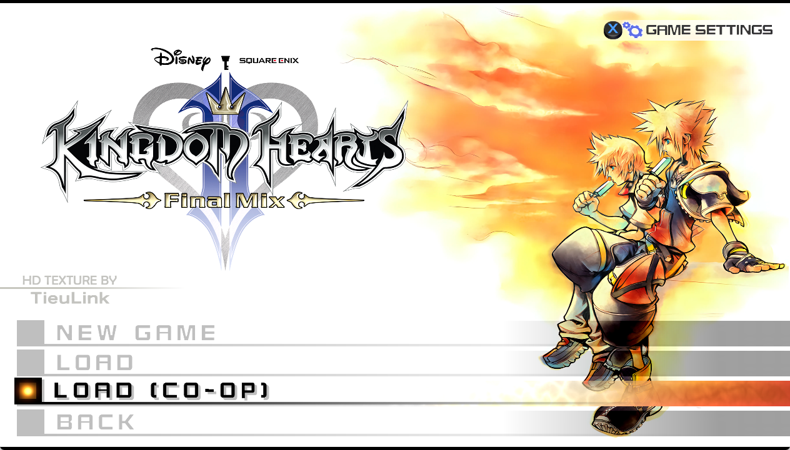

# Kingdom Hearts II Co-op Multiplayer

Online two-player co-op for Kingdom Hearts II Final Mix (PC, Steam). Each player is Sora in their own game, and the other player appears as a second Sora in the party, beside Donald and Goofy. The host's game owns the rooms and enemies; the second game follows it.

**Status:** in development, about half-way to a full story run on two PCs. Tested between two PCs over Steam and over Radmin VPN. There is no installer yet; see [Playing a session](#playing-a-session).

## What works
- Two PCs linked over Steam (Join Game or an invite) or a LAN / VPN address, with a **Connection lost** screen, Continue Alone and rejoining.
- Co-op saves kept apart from your normal saves, through a **LOAD (CO-OP)** row on the title screen.
- Rooms, loading screens, cutscenes and the World Map in step; either player can start the story scenes you walk into.
- Shared enemies and bosses: the second game copies the host's ('one brain'), each hit counts once, and boss HP bars, missions, timers and gauges follow the host's game.
- The other Sora in the party HUD and in story cutscenes, with their spells, Limits, Drive Forms (model, motions and Keyblades) and the world costumes (lion, retro, Halloween; checked on one PC so far).
- Downed state and revives, a shared Game Over and pause, and Mickey's rescue in co-op: one roll for both players, Mickey on both screens, either player can be the one who plays him.
- Companions leave and come back on both screens for Limits, Drive Forms and summons; their KO, HP and MP follow the host's game.
- Bosses' reaction commands go to one player at a time, and either player can use them: Data Roxas's Keyblade steal, Data Xigbar's bouncing-shot and sniper commands, Data Xaldin's Learn and Jump.
- Second Chance and Once More work for both players, and so do the Drive Form level-ups.
- Played together so far: Twilight Town and Hollow Bastion's first visits, the Land of Dragons through Shan-Yu, boss fights in Olympus, Beast's Castle and Agrabah, the final fights to the credits, and the Data Organization fights (from co-op saves).

## What doesn't yet
- Story progress sync between the two saves, the Gummi Ship and the minigames. The World Map works: the host picks the world.
- Each player keeps their own save, level and items. The other screen shows your Sora with the Keyblade you picked (and your form Keyblades in Valor, Master and Final), but with that game's stats.
- Summons aren't shown in the other game, and a party swap isn't copied there.
- Some bosses' special parts differ on the second player's side, and four crashes are open (see [Known issues](#known-issues)).

**Progress: about 56%** of the plan in [`TODO.md`](TODO.md), counting P0 items three times, P1 twice, P2 once and a built-but-untested item as half (re-checked 2026-10-28).

| `TODO.md` items | Done | Built, not tested | Open |
|---|---|---|---|
| P0 (blocks the start-to-finish run) | 36 | 6 | 15 |
| P1 (needed to play well) | 59 | 8 | 57 |
| P2 (polish) | 8 | 0 | 22 |

## Route checklist
✅ played in co-op on two PCs · 🟡 partly · ⬜ not tried. Most worlds are reached by loading a co-op save near the fight, not by playing up to it. Numbers in brackets are `TODO.md` items.

| # | Part | Status |
|---|---|---|
| 1 | Twilight Town and the Mysterious Tower | ✅ story played |
| 2 | Hollow Bastion 1 (the Bailey) | ✅ story played |
| 3 | Land of Dragons 1 (Mulan's missions, Shan-Yu) | 🟡 story played through Shan-Yu, and the swarm climb plays on both screens (its enemies show up to about a second late for the second player, 1.96). Shan-Yu's sword clash doesn't work for the second player yet (1.97, 1.115 fix built) |
| 4 | Beast's Castle 1 (Thresholder, Shadow Stalker / Dark Thorn) | 🟡 Shadow Stalker and Dark Thorn beaten; Thresholder not tried |
| 5 | Olympus Coliseum 1 (Cerberus, Hades escape, Pete, Hydra) | 🟡 story played until Cerberus beaten; the rest not tried |
| 6 | Disney Castle and Timeless River | 🟡 the retro look works on the copy; not played |
| 7 | Port Royal 1 | ⬜ |
| 8 | Agrabah 1 (Volcanic Lord and Blizzard Lord) | 🟡 the Lords beaten, and on to the World Map |
| 9 | Halloween Town 1 | 🟡 the costume works on the copy; not played |
| 10 | Hollow Bastion 2 and Space Paranoids 1 (Demyx, the 1000 Heartless, Light Cycle) | ⬜ the 1000 Heartless battle is a known risk (1.96) |
| 11 | Second visits | ⬜ |
| 12 | Pride Lands (Sora is a lion) | 🟡 the lion works on the copy; not played |
| 13 | Space Paranoids 2 | ⬜ |
| 14 | Twilight Town again, Betwixt and Between | ⬜ |
| 15 | The World That Never Was | 🟡 story fights not tried; the Data Organization fights played from the last save, with open issues (1.82, 1.86, 1.92, 1.94, 1.112–1.114) |
| 16 | Final fights | 🟡 played to the credits; on the second player's side the ship fight isn't in step (1.50) and Armored Xemnas II's shield breaks only from the host's buildings (1.49, fix built) |
| — | World Map and Gummi Ship | 🟡 World Map works; Gummi routes not tried |

## Saves
The title screen gets a **LOAD (CO-OP)** row under LOAD.



- **LOAD (CO-OP)** loads and saves the co-op save file, `KH2 Coop saves\KHIIFM_WW.png` in the game folder (next to the game's exe), and turns co-op on. The first time, the file starts as a copy of your normal saves.
- **NEW GAME** and **LOAD** use your normal Steam saves. The mod stays off, and the game plays as plain KH2.
- Co-op saves never contain the second Sora, so they load like any other save. Playing in co-op never writes your normal saves.

## Playing a session
There's no installer or player guide yet; this is how a test session works today.

**Requirements (both PCs):**
- Kingdom Hearts II Final Mix on Steam (the PC release).
- OpenKH Mods Manager with Panacea, and the mod from `openkh_mod/` installed in it.
- The motion files, built on each PC from that PC's own game files with `tools/make_mset.py`.

**Steps:**
1. In Mods Manager, put KH2 Coop at the top of the list (above texture or voice mods), then Build. Otherwise, those mods cover the LOAD (CO-OP) label.
2. Start the game through Steam or Mods Manager, not by running the game's .exe directly: the mod uses the game's own Steam connection, which only starts that way.
3. Both players pick **LOAD (CO-OP)** on the title screen and load a save.
4. The second player opens the Steam overlay and clicks **Join Game** on the host's profile (or accepts the host's **Invite to Game**). Only the first Steam friend who joins gets in.

The host starts the game with `start_host.bat`, which sets the host's side (`CONNECT=steam`, or `CONNECT=local` for Radmin VPN or LAN; with Local, step 4 isn't needed). The shared settings in `kh2coop.ini` must match on both PCs; if they differ, the log says `SETTINGS DIFFER`. Both PCs also need the same build of the mod: builds that differ ignore each other.

The second player sets the connection in `kh2coop.ini`:

```ini
PEER=steam
; the host's SteamID64 (connect straight to that account); empty = wait for Join Game/invites
STEAM_ID=<SteamID64>
; the host's Local/LAN IP (port 27701 unless written as ip:port), used with PEER=local
LOCAL_IP=<host Local IP>
LISTEN=27702
```

**If the connection drops** (a game closes or crashes, or the network goes): after 3 seconds the other game pauses on a **Connection lost. Reconnecting...** screen. Leave it open to wait; when the other player loads LOAD (CO-OP) again, co-op resumes by itself. Or pick:
- **Continue Alone**: the room reloads without the other Sora. A fight or boss fight starts over. When the other player returns, the room reloads again with their Sora.
- **Title Screen**: back to the title screen through the game's own soft reset.

## Known issues
The full list, with evidence and history, is in [`TODO.md`](TODO.md). The ones you are most likely to meet:
- Steam achievements are blocked while co-op is on. `ACHIEVEMENTS=1` in `kh2coop_player.ini` allows them on that PC.
- Drive Forms on the other Sora: Wisdom's attacks show melee effects and no shots; after a room change in a form the shimmer can stay on the copy (1.106, fix built).
- Limits: a Limit with Goofy can show idle on the other screen (1.65); after the second player's Limit the host's companion can stay away until the next room (1.108, fix built); Limit Form's Limits crashed the other player's game (1.118, fix built).
- Summons aren't shown in the other game (1.61); Donald's and Goofy's Limits used by the second player don't show on the host's screen (1.60); a party swap isn't copied (1.51).
- Bosses: Data Xigbar's sniper view shows only on the host's screen (1.82), and the second player's Sora can turn invisible after his sniper round (1.86); Data Luxord can stall or die early (1.92, 1.94), the second player doesn't become his die or card and his camera can stay on the minigame (1.90, 1.120); Data Xigbar's bouncing shots can stay on the second player's screen (1.121); Data Saïx's Berserk T-poses on the second player's screen (1.63); in Data Final Xemnas the second player's game crashed once (1.113) and the fixes for his desperation move are waiting for a test (1.112, 1.114); Armored Xemnas II's shield breaks only from the host's buildings, and pressing a building's command at the same moment as the host can leave the second player stuck (1.49, fix built); the host's game quit once in Final Xemnas (1.119); a reaction command pressed twice can run twice (1.101); the Samurai duel can freeze the second user (1.47).
- In swarm fights the second player's enemies can show up about a second late, and the 1000 Heartless battle isn't tried yet (1.96).
- A few things show only in the host's game: the Land of Dragons wind gusts and the Twin Lords' minions (1.53). Mickey's help stars show only over the winner's Sora (1.95).

## Videos
**Steam connection and gameplay** (October 11, 2026). Two PCs, host on the left, client on the right; the client joins through the Steam overlay. Combat and the downed / revive animation.

https://github.com/user-attachments/assets/7729c35f-9265-43c8-bd39-6e0143e6bd12

Higher quality: https://www.youtube.com/watch?v=IJ1MecbHULk. A first-visit run through Twilight Town, Hollow Bastion and the Land of Dragons: https://www.youtube.com/watch?v=6iT6TXw1hiA

**Cinematics** (October 11, 2026). A 'Twin Sora' follows Sora in every cutscene that has him; close-ups show one Sora. `CUTSCENE_TWIN=0` in `kh2coop_player.ini` turns it off.

https://github.com/user-attachments/assets/e788f2e3-3344-443e-82d8-c7cf5cf82415

**Mickey revival** (October 19, 2026). Both players roll a hidden number; if both pass the game's threshold, the higher roll plays Mickey. Mickey revives both players; if he drops to 1 HP, the partner gets up after 30 seconds or when healed. Since the recording, Mickey also shows on the other player's screen.

https://github.com/user-attachments/assets/8653698c-f2cf-47c4-8a69-19c07efb3160

## Layout
- `src/dll/`: the C++ DLL. OpenKH Panacea loads it from the OpenKH mod in `openkh_mod/`. Hooks use MinHook.
- `tools/`: Python helpers for building, launching test copies, packaging, and research.
- Settings: `kh2coop.ini` (shared, must match on both PCs; also holds the connection, `PEER`) and `kh2coop_player.ini` (personal, written by the DLL with defaults on first start).
- `start_host.bat`: starts the host's game; `CONNECT=steam` or `CONNECT=local` picks how the second player connects.
- Documents: [`TODO.md`](TODO.md) (the plan and what's left), [`MODLOG.md`](MODLOG.md) (the development diary, with evidence), [`VERIFIED_OFFSETS.md`](VERIFIED_OFFSETS.md) (addresses, structures and game rules found on the Steam build), [`docs/DECISIONS.md`](docs/DECISIONS.md) (the co-op rules), [`docs/CRASH_RISK_REVIEW.md`](docs/CRASH_RISK_REVIEW.md) (where the DLL can crash the game, and what to change), [`docs/FILE_HEAP.md`](docs/FILE_HEAP.md) (how the game's file heap works: the list, the groups, the layout, the top blocks), [`docs/EFFECT_SYNC_PLAN.md`](docs/EFFECT_SYNC_PLAN.md) (the plan for the particles missing in the other game), [`MODDING_PLAN.md`](MODDING_PLAN.md) (the original plan).

## License
Copyright (C) 2026 TCM-Murray

This program is free software: you can redistribute it and/or modify it under the terms of the GNU General Public License as published by the Free Software Foundation, either version 3 of the License, or (at your option) any later version. It is distributed WITHOUT ANY WARRANTY; see [`LICENSE`](LICENSE) for details. SPDX: `GPL-3.0-or-later`.

Third-party code: [MinHook](https://github.com/TsudaKageyu/minhook) (BSD-2-Clause), downloaded at build time.

## Credits
- **[Volpestyle/kh2-multiplayer](https://github.com/Volpestyle/kh2-multiplayer)** (GPL-3.0-or-later): this project uses their documentation and research (pointer maps, hook points, input, enemy and save-guard notes) as leads; every address taken from it is re-checked on our build before use (`VERIFIED_OFFSETS.md`).
- **[OpenKH](https://github.com/OpenKH/OpenKh)**: Panacea loads the mod's DLL, and its documentation and file-format code (e.g., the event script layout) are used as references.
- **[Expert595/kh2-multiplayer](https://github.com/Expert595/kh2-multiplayer)** and the KH2 Lua library: a few addresses used as leads.
- **[Julumisan/kh-pc-save-transfer](https://github.com/Julumisan/kh-pc-save-transfer)** (MIT): recommended to the second player for moving the host's save between Steam accounts; not included in this repository.

Kingdom Hearts and Kingdom Hearts II are the property of Square Enix and Disney. This is an unofficial fan project, not affiliated with or endorsed by them. The repository contains no game files; you need your own copy of the game.

Developed with the help of Claude (Anthropic).
